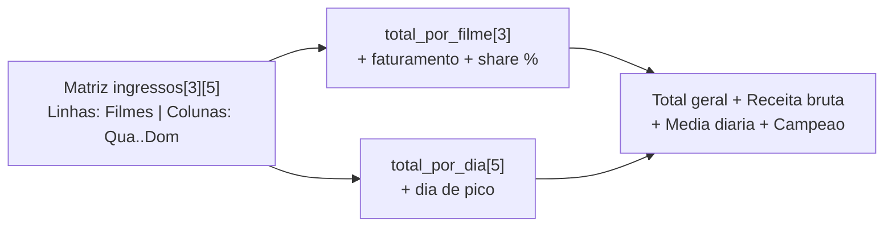

# Controle de Bilheteria de Cinema com Matrizes em C11

Sistema de análise semanal de bilheteria modelado em **C11** com matrizes bidimensionais (`3 filmes × 5 dias`) e vetores acumuladores. Calcula faturamento exato em centavos (`int64_t`), participação percentual por filme, totais por linha e coluna, filme campeão e dia de pico — com modo interativo, testes unitários e CI automatizado em `gcc` e `clang` com AddressSanitizer/UBSan.

[](https://github.com/cgn2222/ads-algoritmos-bilheteria-cinema/actions/workflows/ci.yml)


---

## Modelo matricial



---

## Como compilar e executar

```bash
# Compilar (-std=c11 -Wall -Wextra -Wpedantic -Werror)
make

# Executar relatorio semanal padrao (matriz 3x5)
make run

# Executar em modo interativo (digitando os ingressos por filme/dia)
make interactive

# Rodar testes unitarios + testes de integracao da CLI
make test

# Rodar testes com AddressSanitizer e UndefinedBehaviorSanitizer
make sanitize
```

### Exemplo de saída (`make run`)

```text
=========================================================================================
                  SISTEMA DE CONTROLE DE BILHETERIA E VENDAS DE CINEMA
=========================================================================================
Valor padrao do ingresso: R$ 30.00

FILME / DIAS                 |  Qua |  Qui |  Sex |  Sab |  Dom |  TOTAL |  FATURAMENTO |  SHARE
-----------------------------------------------------------------------------------------
Avatar: O Caminho da Agua    |  120 |  150 |  280 |  420 |  390 |   1360 | R$  40800.00 |  33.4%
Vingadores: Ultimato         |  140 |  180 |  310 |  490 |  460 |   1580 | R$  47400.00 |  38.8%
Oppenheimer                  |   95 |  130 |  240 |  360 |  310 |   1135 | R$  34050.00 |  27.9%
=========================================================================================
TOTAL POR DIA                |  355 |  460 |  830 | 1270 | 1160 |   4075 | R$ 122250.00 | 100.0%
=========================================================================================

------------------------------ METRICAS CONSOLIDADAS ------------------------------------
 -> Total Geral de Ingressos Vendidos : 4075 ingressos
 -> Receita Bruta Total Acumulada     : R$ 122250.00
 -> Media de Publico por Dia          : 815.00 espectadores/dia
 -> Filme Campeao de Bilheteria       : Vingadores: Ultimato (1580 ingressos | R$ 47400.00)
 -> Dia de Maior Movimento            : Sabado (1270 ingressos)
=========================================================================================
```

---

## Decisões de engenharia e trade-offs

| Decisão | Justificativa | Trade-off / Evolução |
| --- | --- | --- |
| **Percurso *row-major* (`i` externo, `j` interno)** | Em C, matrizes são armazenadas contiguamente por linha; percorrer `ingressos[i][j]` maximiza localidade espacial de cache e agrega linha e coluna em uma única passagem $O(F \times D)$. | Em matrizes gigantes, mantém padrão de acesso sequencial previsível pelo *hardware prefetcher*. |
| **Faturamento em `int64_t` centavos com guarda de overflow** | Evita erro de arredondamento acumulado de `float` e protege contra estouro inteiro antes da multiplicação. | Exige formatação dedicada (`bilheteria_formatar_reais`), mantendo o núcleo de cálculo exato. |
| **Desempate determinístico (menor índice)** | Em caso de empate de público ou matriz totalmente zerada, o comportamento é documentado e coberto por teste unitário. | Para relatórios comerciais que exibem múltiplos empatados, evoluir para retornar um vetor de índices vencedores. |
| **Dimensões fixas (`3 × 5`) em tempo de compilação** | Espelha diretamente o escopo da disciplina com alocação 100% em stack (zero vazamentos). | Para um número dinâmico de salas/sessões, evoluir para alocação contígua 1D (`ingressos[i * num_dias + j]`). |

---

## Estrutura do repositório

```text
ads-algoritmos-bilheteria-cinema/
├── .github/workflows/ci.yml   # CI com gcc, clang, ASan e UBSan
├── Makefile                   # Build estrito C11, testes e sanitizers
├── src/
│   ├── bilheteria.h           # Contratos, RelatorioBilheteria e BilheteriaStatus
│   ├── bilheteria.c           # Motor de agregacao matricial e metricas
│   └── main.c                 # Relatorio tabular e modo --interativo
└── tests/
    ├── test_bilheteria.c      # Testes unitarios (padrao, zeros, empates, erros)
    └── test_cli.sh            # Teste ponta a ponta da CLI
```

---

## Créditos

Desenvolvido por **Carlos Gabriel Novo** no curso superior de tecnologia em **Análise e Desenvolvimento de Sistemas** (Cruzeiro do Sul Virtual, 2026) — disciplina de *Algoritmos e Pensamento Computacional* (Experiência Prática III).

Distribuído sob licença **MIT** ([`LICENSE`](LICENSE)).
